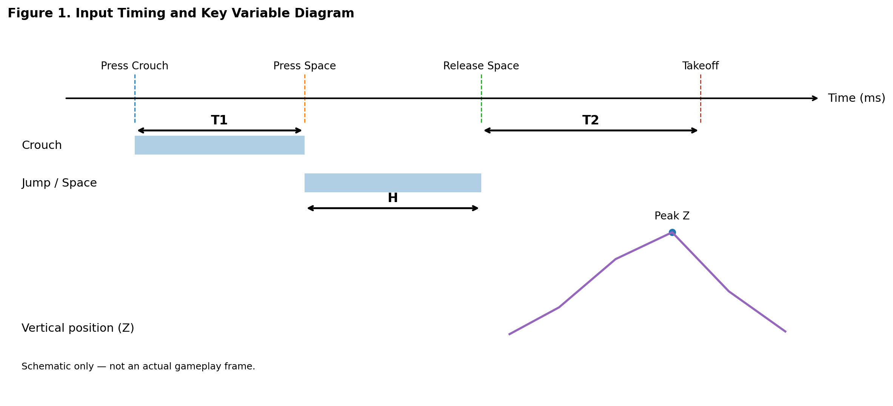
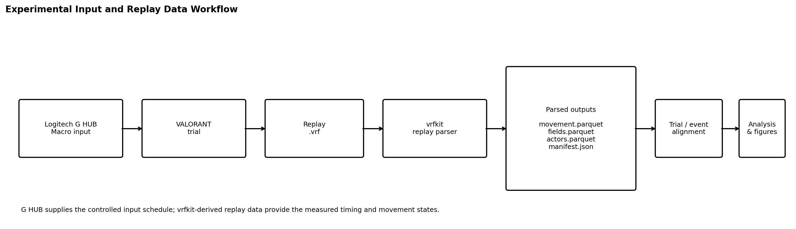
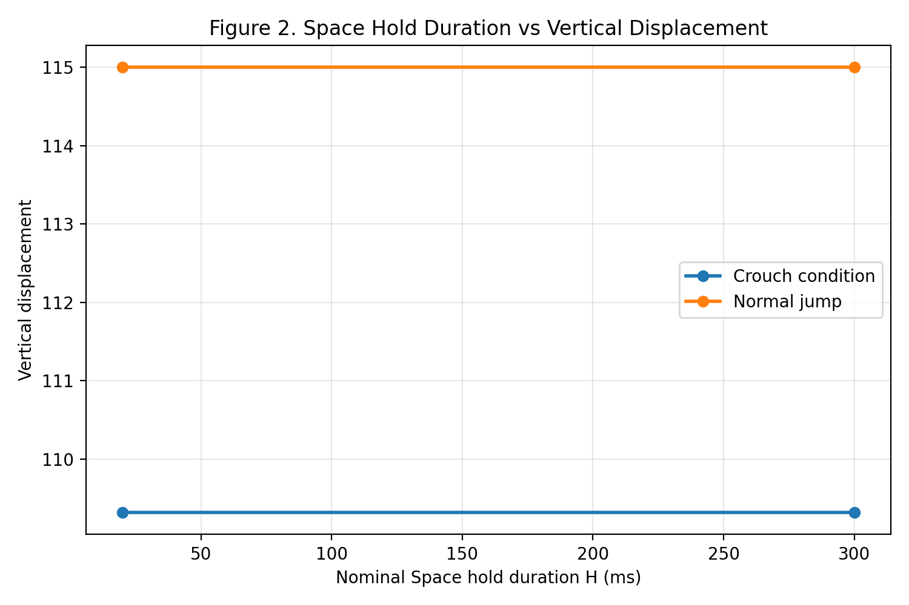
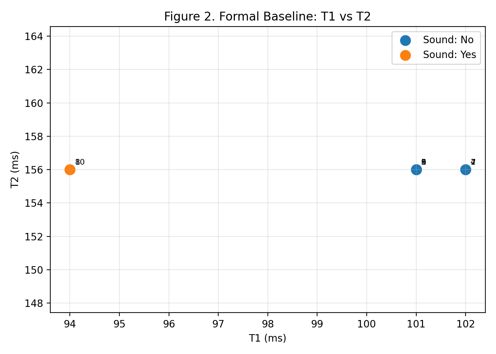
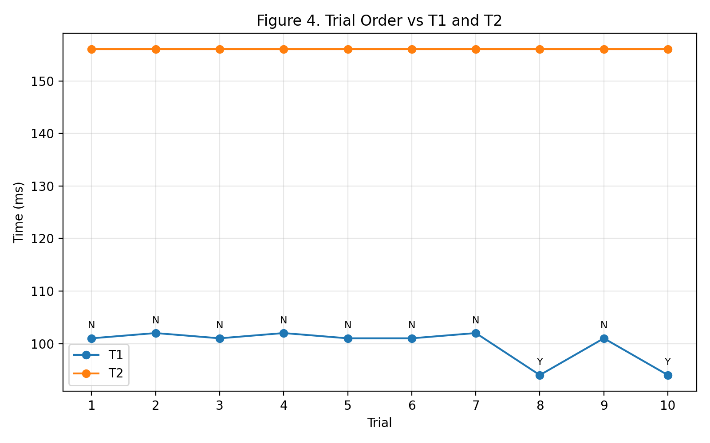
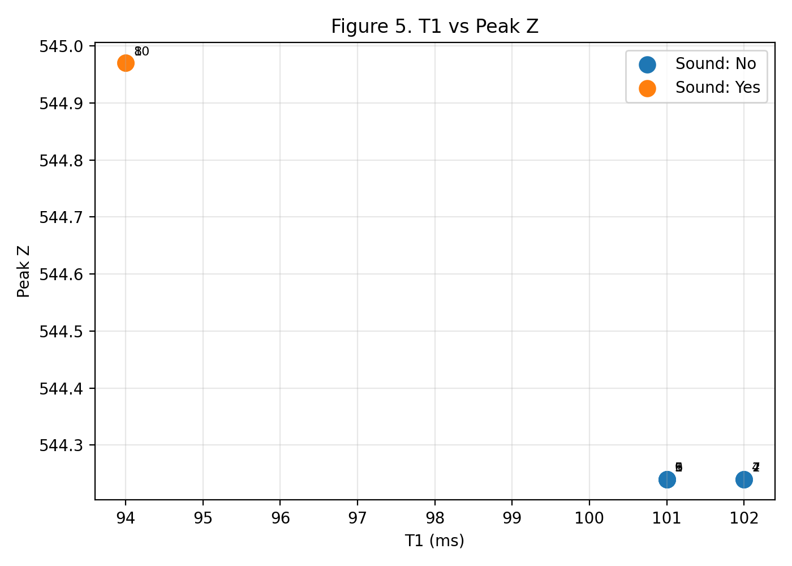
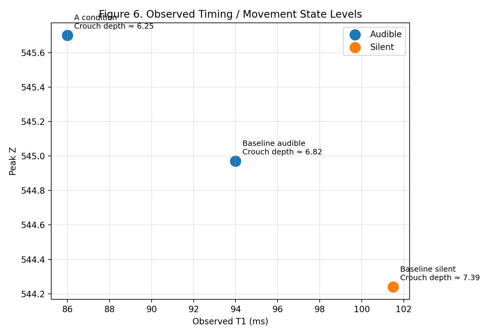

# Experimental Study of Silent Jump Timing and Movement States in VALORANT

*A replay-based analysis of T1, T2, crouch state, jump height, and sound outcome*

**English** | [中文](README.zh-CN.md)

> This is an independent community research project and is not affiliated with, endorsed by, or sponsored by Riot Games.

## Abstract

This experiment investigates the relationship between the silent-jump phenomenon in VALORANT, input timing, and character movement state, and attempts to identify the highest jump state that can be reached without producing an audible jump sound. The experiment controlled the timing relationship between Crouch and Space/Jump, tested different Space hold durations, and then used parsed replay data to recover actual input timing, movement trajectory, and maximum vertical position (Peak Z). VALORANT `.vrf` replay parsing and Parquet export were performed with [`vrfkit`](https://github.com/yakisoba0728/vrfkit), and the resulting structured data were aligned with manually recorded audible/silent outcomes.

The Space-duration comparison found that changing H from approximately 20 ms to approximately 300 ms did not meaningfully change the jump trajectory under the same Crouch condition. In the formal 10-trial baseline, trials 8 and 10 were audible while the other eight were silent. Replay alignment showed that T2 remained approximately 156 ms, while T1 separated the two outcomes: T1≈94 ms was audible and T1≈101–102 ms was silent.

The silent baseline state reached Peak Z≈544.24, while the next higher observed state, Peak Z≈544.97, was audible. Therefore, 544.24 is currently treated as the highest **observed** silent state under the tested conditions, not as a proven absolute game limit. Because the sound transition, crouch state, and Peak Z repeatedly occur in discrete-looking levels, a working hypothesis is that the silent-jump boundary may depend on a discrete movement/update state rather than a purely continuous millisecond threshold.

---

## 1. Research Background and Questions

Jumping in VALORANT normally produces an audible cue, so a jump can affect both movement and information exposure. In practical testing, certain Crouch + Jump input timings can produce a jump without the normally audible jump sound. This report refers to that behavior as a **silent jump**.

The same configured delay does not always produce the same outcome. Therefore, the configured macro timing alone is not sufficient to explain the mechanic. This study instead uses replay data to examine actual timing and movement state.

The second experiment also used explicit segmentation. After one incorrectly executed baseline sequence, five consecutive melee attacks were used as a replay marker. A new 10-trial formal baseline was then performed. Trials 8 and 10 were manually identified as audible, while the remaining eight were silent. A separate shorter-T1 A condition was audible on every trial.



**Figure 1. Input timing and key variable diagram.** This is a schematic used to define T1, T2, H, takeoff, and Peak Z; it is not an actual gameplay frame.

### Research questions

1. Does Space hold duration H affect jump trajectory or sound outcome?
2. Does Crouch state change the actual jump trajectory?
3. Which variable, T1 or T2, is more strongly associated with sound outcome?
4. Is there a narrow critical timing region for the silent-jump transition?
5. Could the transition be associated with a discrete movement/update state?
6. What is the highest currently observed jump state that remains silent?

---

## 2. Variable Definitions

| Variable | Definition | Unit | Notes |
|---|---|---:|---|
| T1 | Time interval between Crouch input and Space/Jump input | ms | Strongest current timing correlate of sound outcome |
| H | Actual duration for which Space is held | ms | Press Space → release Space |
| T2 | Time from Space release to the takeoff/leave-ground event | ms | Approximately 156 ms in the formal baseline |
| Peak Z | Maximum vertical coordinate reached during a jump | game coordinate units | Used to compare jump states |
| Crouch depth | Degree of crouch state near takeoff | game-data units | Used to compare takeoff state levels |
| Sound | Whether an audible jump sound was heard | Yes / No | Manually labeled during the experiment |
| Trial | One complete test execution | count | Used to align manual notes and replay data |

Peak Z is an absolute replay coordinate. It should not automatically be interpreted as relative jump height when the starting position differs between experimental groups.

---

## 3. Experimental Environment, Tooling, and Data

### 3.1 Replay and parsed files

| Item | Value |
|---|---|
| Replay build | `++Ares-Core+release-13.06` |
| Replay version | `5.3.2` |
| Replay duration | 1,019,345 ms (~16 min 59 s) |
| Source size | 3,360,781 bytes |
| Movement rows | 130,433 |
| Network packets | 160,903 |
| Malformed packets | 0 |
| Partial rows | 0 |
| Main player subjects | 1 |

Replay parsing was performed with [`vrfkit`](https://github.com/yakisoba0728/vrfkit), a Rust toolkit for parsing VALORANT `.vrf` replay files and exporting their contents to Parquet. In this study, `vrfkit` provided the structured movement, field/state, actor, and manifest data used for timing and movement analysis. The relevant outputs included `movement.parquet`, `fields.parquet`, `actors.parquet`, and `manifest.json`.



**Experimental input and replay-data workflow.** Logitech G HUB Macro provides the controlled Crouch/Space input schedule, VALORANT records the resulting `.vrf` replay, and `vrfkit` converts that replay into structured tables that are aligned with the manual trial log for timing, movement-state, and figure generation.

The replay did not show malformed packets or partial rows in the parser summary. This does not mean every internal game state has been decoded; the jump-sound trigger itself has not yet been directly identified as a replay field.

### 3.2 Input execution with Logitech G HUB macros

The repeated input sequences were executed using the **macro functionality in Logitech G HUB**. G HUB was used to issue controlled Crouch and Space/Jump key sequences with configured delay values, including the nominal 20 ms and 300 ms Space-hold conditions and the timing variants used in the baseline/A-condition tests.

The configured macro delays are treated only as the **intended input schedule**. They are not assumed to be identical to the timing actually processed by the game. For this reason, the analysis distinguishes nominal macro settings from replay-measured values. T1, T2, H, takeoff state, and Peak Z reported in the results are based on the events reconstructed from the replay data rather than solely on the values entered in G HUB.

This distinction is important because identical or nearby macro settings can still resolve to different observed timing states in the replay. The macro therefore serves as the controlled input source, while `vrfkit` replay data serve as the measurement source.

### 3.3 Experimental order

1. 20 ms Space × 5
2. 300 ms Space × 5
3. 20 ms Space + Crouch × 5
4. 300 ms Space + Crouch × 5
5. Incorrect baseline sequence — excluded
6. Five melee attacks as a replay marker
7. Formal baseline × 10
8. A condition with shorter T1

The five melee marker events were located around 868.102–871.313 s, which made it possible to separate the invalid baseline from the formal baseline reliably.

### 3.4 Sound labels

For the formal baseline:

- Trial 8: audible
- Trial 10: audible
- Other 8 trials: silent

For the A condition, every trial was audible.

Sound was manually classified by listening. This is a limitation discussed later.

---

## 4. Results

### 4.1 Space hold duration H

| Condition | Actual H | Peak Z | Vertical displacement | Airtime |
|---|---:|---:|---:|---:|
| 20 ms Space | ~15–24 ms, mean ~17.0 ms | 554.47 | 115.00 | ~671.8 ms |
| 300 ms Space | ~297 ms | 554.47 | 115.00 | ~672.0 ms |
| 20 ms Space + Crouch | ~15–23 ms, mean ~18.4 ms | 528.79 | 109.32 | ~656.2 ms |
| 300 ms Space + Crouch | ~297–305 ms, mean ~300.2 ms | 528.81 | 109.32 | ~656.2 ms |

Under the same Crouch condition, increasing H from approximately 20 ms to approximately 300 ms produced almost no change in Peak Z, vertical displacement, or airtime. H therefore does not currently explain the audible/silent transition.

The difference between normal jump and Crouch-condition jump is much larger, confirming that crouch state changes the observed movement trajectory.



**Figure 2. Space hold duration vs vertical displacement.** Within each movement condition, changing nominal H from 20 ms to 300 ms leaves vertical displacement essentially unchanged, while the normal-jump and Crouch-condition trajectories remain clearly separated.

### 4.2 Formal baseline: T1 and T2

| Trial | T1 (ms) | T2 (ms) | Peak Z | Sound |
|---:|---:|---:|---:|:---:|
| 1 | 101 | 156 | 544.24 | No |
| 2 | 102 | 156 | 544.24 | No |
| 3 | 101 | 156 | 544.24 | No |
| 4 | 102 | 156 | 544.24 | No |
| 5 | 101 | 156 | 544.24 | No |
| 6 | 101 | 156 | 544.24 | No |
| 7 | 102 | 156 | 544.24 | No |
| 8 | 94 | 156 | 544.97 | Yes |
| 9 | 101 | 156 | 544.24 | No |
| 10 | 94 | 156 | 544.97 | Yes |

T2 stays at approximately 156 ms in all ten formal baseline trials. T1 separates the outcomes:

- **94 ms:** 2/2 audible
- **101–102 ms:** 8/8 silent



**Figure 3. Formal baseline T1 vs T2.** T2 remains effectively fixed, while sound outcome separates by T1.

### 4.3 Trial order

Trials 1–7 are all in the 101–102 ms state and are silent. Trial 8 drops to 94 ms and becomes audible. Trial 9 returns to 101 ms and becomes silent again. Trial 10 drops to 94 ms and is audible again.



**Figure 4. Trial order vs T1/T2.** “Y” indicates an audible trial; “N” indicates a silent trial.

The audible trials were identified by listening before replay alignment. Their later alignment with the distinct 94 ms T1 level is therefore especially important.

### 4.4 T1 and Peak Z

- T1≈101–102 ms → Peak Z≈544.24 → silent
- T1≈94 ms → Peak Z≈544.97 → audible



**Figure 5. T1 vs Peak Z.** In the formal baseline, the higher Peak Z state is audible, while the slightly lower state is silent.

The difference between the two Peak Z levels is approximately 0.73 coordinate units. Under the same formal baseline conditions, this is a repeatable observable difference between the two takeoff states.

### 4.5 Crouch-state levels

Replay alignment also showed different crouch depths near takeoff:

- T1≈101–102 ms, silent: crouch depth ≈7.39
- T1≈94 ms, audible: crouch depth ≈6.82

A shorter-T1 A state also appeared around T1≈86 ms, crouch depth≈6.25, with Peak Z≈545.70, and remained audible.



**Figure 6. Observed timing and movement state levels.** Adding the A condition shows three repeated state levels: an earlier high/audible A state, the 94 ms baseline audible state, and the later 101–102 ms silent state. The labels include the corresponding observed crouch-depth level.

These observations do not prove that crouch depth directly controls the sound. They show that T1, crouch state, Peak Z, and Sound change together in the current data.

### 4.6 Highest observed silent state

Within the directly comparable formal baseline samples:

- highest confirmed silent Peak Z: **~544.24**
- next higher observed state: **~544.97**, audible

Therefore, 544.24 is currently the strongest candidate for the **highest observed silent state**, but not a proven absolute mechanical limit.

---

## 5. Discussion

### 5.1 H is not the primary variable

The 20 ms vs 300 ms comparison indicates that Space hold duration alone does not substantially change the jump trajectory under the same Crouch state. This eliminates a simple explanation based on how long Space is held.

### 5.2 T1 is the strongest current timing variable

T2 stays approximately constant while Sound changes. T1 changes in the same trials that Sound changes, and the shorter A-condition T1 values also remain audible. T1 is therefore the strongest current timing variable associated with the silent state.

This should not be simplified to “larger T1 is always better” or “100 ms is a magic number.” The current result is narrower: the observed 101–102 ms state is silent while the adjacent earlier 94 ms state is audible.

### 5.3 Discrete-state hypothesis

The observed levels are:

| State | T1 | Crouch depth | Peak Z | Sound |
|---|---:|---:|---:|:---:|
| Earlier takeoff state | ~94 ms | ~6.82 | ~544.97 | Yes |
| Later takeoff state | ~101–102 ms | ~7.39 | ~544.24 | No |
| Earlier A-condition state | ~86 ms | ~6.25 | ~545.70 | Yes |

The gap between 94 ms and 101–102 ms is only about 7–8 ms, yet the observations repeatedly fall into distinct-looking states. A working hypothesis is that Jump is being processed during different discrete Crouch/Movement update states.

This is **not yet a confirmed internal game mechanic**. It is a hypothesis that fits the current observations and needs further testing.

### 5.4 Peak Z may be an outcome rather than the sound switch

The current data do not prove that Peak Z itself directly controls sound. A more cautious model is:

1. T1 affects which movement state is active when Jump is processed.
2. That state changes takeoff trajectory and Peak Z.
3. The same state may also affect whether the jump sound is triggered.

Under this model, Peak Z is an observable consequence of the internal state rather than the sound trigger itself.

---

## 6. Limitations

1. **Manual sound labels.** Sound was classified by listening rather than by an independently parsed sound event or waveform analysis.
2. **Small sample size.** The formal baseline contains only 10 trials, with only two audible samples at 94 ms.
3. **Sparse critical-region sampling.** The 95–100 ms region has not yet been sampled densely.
4. **Peak Z is an absolute coordinate.** Cross-condition comparisons require care when starting position differs.
5. **Sound trigger not directly decoded.** Current evidence is correlational with respect to the internal sound event.
6. **Version/environment dependence.** Exact values may change with game updates or different experimental conditions.

---

## 7. Next Experiment

The next experiment should focus on the **94–102 ms critical region**, rather than scanning much shorter values broadly.

Recommended measurements per trial:

- actual T1
- T2
- H
- pre-takeoff / takeoff Z
- crouch depth
- Peak Z
- vertical displacement
- Sound
- trial order

Where possible, each important actual timing state should accumulate at least ~20 valid repetitions. Future testing should also record game audio so that manual sound labels can be checked against recorded audio.

The five-melee-attack marker worked well and should be retained or expanded into a consistent event-marker protocol between parameter blocks.

---

## 8. Conclusion

The current experiment supports five main observations:

1. Changing Space hold duration H from approximately 20 ms to approximately 300 ms does not meaningfully alter the jump trajectory under the same Crouch condition.
2. Crouch state clearly affects the observed jump trajectory.
3. In the formal baseline, T2 remains approximately 156 ms while T1 separates sound outcome: 94 ms is audible, while 101–102 ms is silent.
4. The silent T1 state is also associated with a deeper crouch level and a lower Peak Z, suggesting that these measurements reflect a common movement-state change.
5. The highest currently confirmed silent Peak Z is approximately **544.24**; the next higher observed state, approximately **544.97**, is audible.

The most important unresolved question is whether the 7–8 ms boundary reflects a continuous timing threshold or a discrete internal movement/update state. The next experiment should therefore densely sample the 94–102 ms region and increase the number of repetitions.

---

## Reproducibility and Data

### Replay parser

Replay extraction for this study was performed with [`vrfkit`](https://github.com/yakisoba0728/vrfkit). `vrfkit` parses VALORANT `.vrf` network replays and exports structured Parquet data that can be analyzed with tools such as pandas. This repository contains the derived summary data and plotting code used for the public figures; it does not currently redistribute the original replay.

### Public data

The formal baseline data used for the public figures are available at:

- [`data/baseline_verified_trials.csv`](data/baseline_verified_trials.csv)

Figures can be regenerated with:

```powershell
python .\generate_figures.py
```

---

## Disclaimer

This repository is an independent community research project. It is not affiliated with, endorsed by, or sponsored by Riot Games.

VALORANT and related properties are trademarks or registered trademarks of Riot Games, Inc. This repository uses the game name only to identify the subject of the study.

## License

No license has been selected yet. Until a license is added, normal copyright rules apply to the original report, figures, data organization, and code in this repository.
